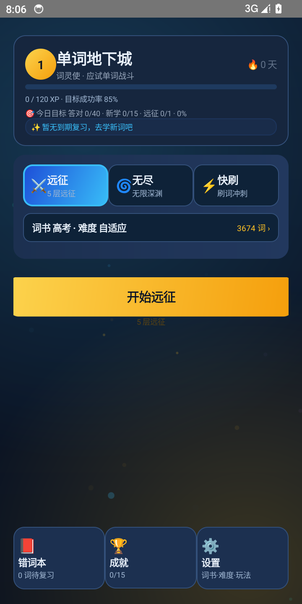
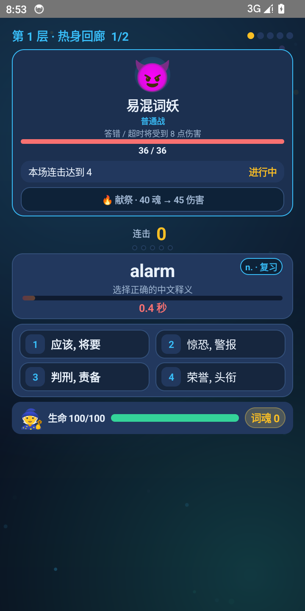
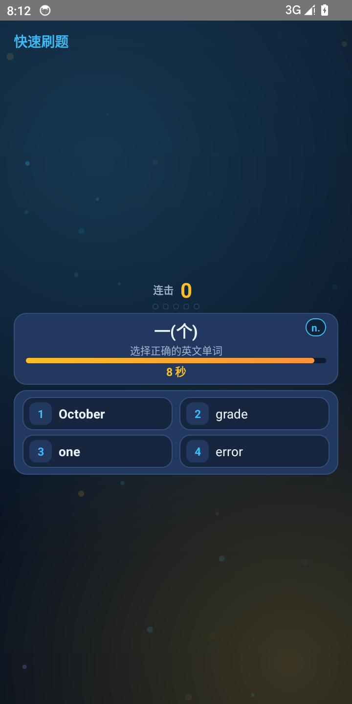
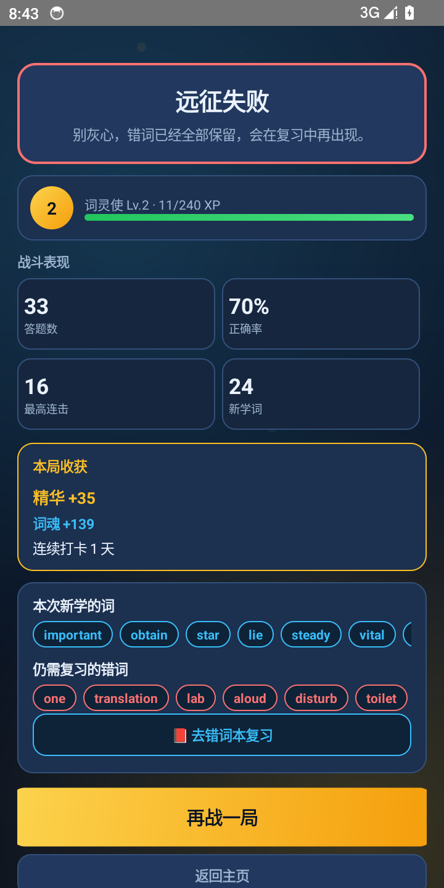
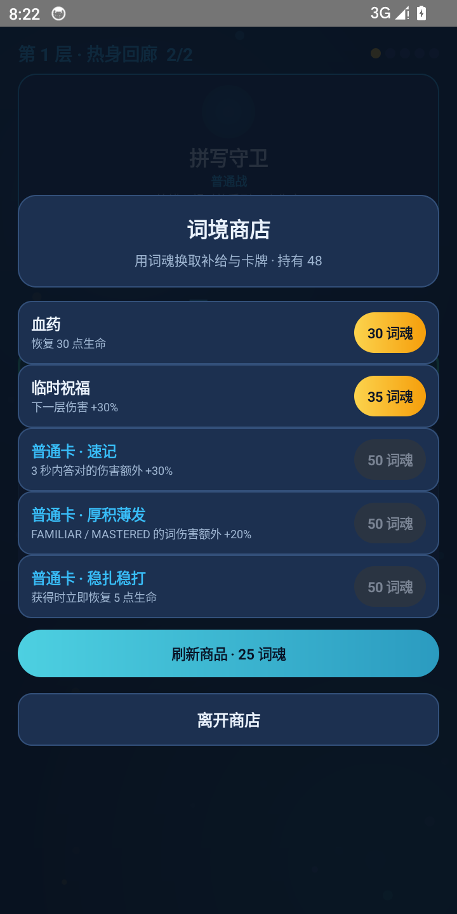
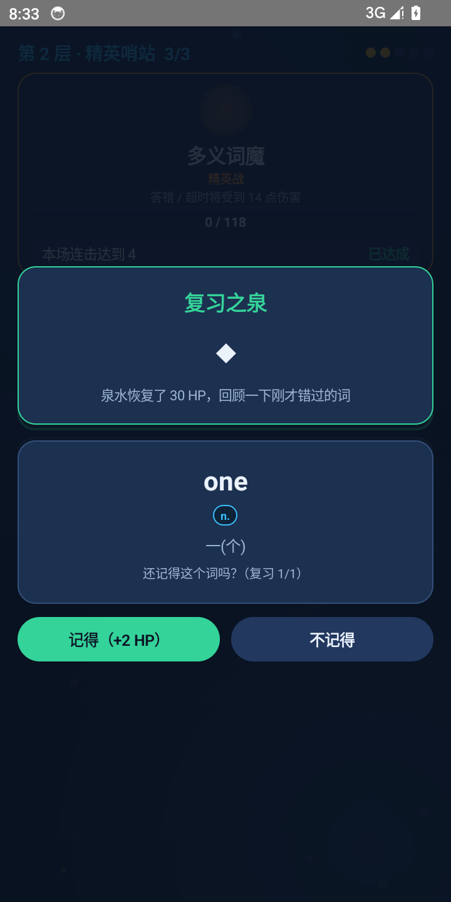
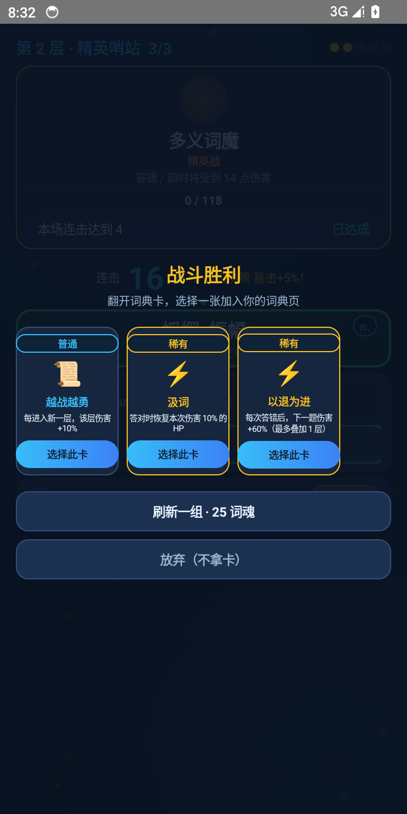
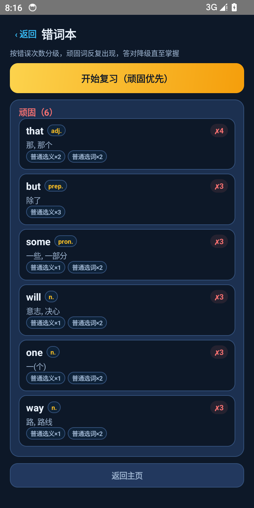

# 单词地下城 · Word Dungeon

> 应试单词 · 战斗 Roguelike。认出一个单词就是一次攻击，答错一次就会挨打；错词按错误次数分级，顽固词会反复出现，直到你真正掌握。

一个可直接安装运行的 **Android 原生单机背词应用**：内置 8920 个单词、5 本考试词书，把答题的正误与快慢转化为直观的战斗攻防、连击与成长反馈，并通过错词分级、间隔重复和快刷新词调度，让复习节奏贴合记忆规律。全程本地运行，**无账号、无广告、不连服务器、不采集数据**，无网络环境也能完整使用。

- 纯 Java 原生开发，界面全部用 Canvas 自绘，不依赖第三方 UI / 游戏引擎
- 进程内本地路由承载业务逻辑，没有 HTTP / Socket 网络服务
- SQLite 本地存储，音效由 AudioTrack 实时合成，零外部音频资源

## 界面速览

<table>
  <tr>
    <td align="center"><b>主页</b><br>模式切换 · 词书难度 · 今日复习</td>
    <td align="center"><b>远征战斗</b><br>敌人血条 · 倒计时 · 题型阶梯</td>
  </tr>
  <tr>
    <td align="center"></td>
    <td align="center"></td>
  </tr>
  <tr>
    <td align="center"><b>快刷战斗</b><br>词频加权 · 高频集中刷词</td>
    <td align="center"><b>结算页</b><br>正确率 · 连击 · 新学词与错词</td>
  </tr>
  <tr>
    <td align="center"></td>
    <td align="center"></td>
  </tr>
  <tr>
    <td align="center"><b>词境商店</b><br>词魂兑换补给与词典卡</td>
    <td align="center"><b>复习之泉</b><br>回血并复盘本层错词</td>
  </tr>
  <tr>
    <td align="center"></td>
    <td align="center"></td>
  </tr>
  <tr>
    <td align="center"><b>翻牌抽卡</b><br>稀有度保底 · 史诗压轴</td>
    <td align="center"><b>错词本</b><br>顽固 / 易错 / 生疏分级</td>
  </tr>
  <tr>
    <td align="center"></td>
    <td align="center"></td>
  </tr>
</table>

## 1. 快速开始

环境要求：**JDK 17** 与 **Android SDK**（compileSdk / targetSdk 34、build-tools 34.0.0）；最低支持 Android 5.1（minSdk 22）。工程为纯原生 Gradle 项目，无需 Node、Capacitor 或任何后端服务。

```bash
# 1) 克隆仓库并进入 Android 工程
git clone git@github.com:Guzifeng0613/word-chanllenge.git
cd word-chanllenge/android

# 2) 构建调试版 APK
./gradlew assembleDebug

# 3) 构建发布版 APK
./gradlew assembleRelease

# 4) 直接安装到已连接的设备或模拟器
./gradlew installDebug
```

构建产物路径：

```text
app/build/outputs/apk/debug/app-debug.apk        # 调试版
app/build/outputs/apk/release/app-release.apk    # 发布版
```

可用 aapt2 核验安装包版本号：

```bash
aapt2 dump badging app/build/outputs/apk/release/app-release.apk | grep versionName
```

Windows 环境下把 `./gradlew` 替换为 `gradlew.bat` 即可，命令与参数完全一致。

## 2. 三种玩法模式

| 模式 | 玩法 | 适合场景 |
| --- | --- | --- |
| **远征** | 逐层闯关的地下城，每层含普通敌人、精英怪与守层 Boss，拼写题比例与敌人强度随层数提升 | 系统学习主线，从新词到通关完整闭环 |
| **无尽** | 无层数上限的深渊，敌人生命每层 +15%、攻击每层 +10%，定期轮换 Boss 模板 | 已有词汇量后的持续挑战与冲榜 |
| **快刷** | 分普通 / 进阶 / 地狱三档，按词频加权抽取高频词，普通档启用新词调度状态机 | 考前集中、快速过词 |

## 3. 答题与记忆引擎

**四种题型**在单词毕业前沿阶梯推进：快速判断（judge）→ 看英文选中文（en2cn）→ 看中文选英文（cn2en）→ 单词拼写（spell），毕业后在复习题型中轮换。选择题的三个干扰项优先取同词性、拼写或含义相近的单词，并结合 18 组易混词数据构造，避免随机干扰项缺乏迷惑性。

- **错词三级**：答错 1 次为生疏、2 次为易错、3 次及以上为顽固，出题权重逐级提高；本局答错的单词间隔若干题后重新插入，及时纠正。
- **自适应能力值**：取值 1～3，初始 1.5，答对上升、答错下降；自适应难度下约七成题目匹配当前能力，其余向上下拉伸，难度随能力动态变化。
- **间隔重复**：毕业前走学习阶梯，答错安排 2 / 3 / 5 分钟后的短期到期；毕业后按 `10 分钟 → 1 天 → 3 天 → 7 天 → 16 天 → 30 天` 六级间隔复习，连对晋升、答错回退。
- **快刷状态机**：普通档新词答错隔 5 题重投，答对按连对次数隔 10 / 15 / 25 题重投，同一词出现满 4 次强制毕业，防止无限循环。
- **每日复习配额**：默认每天 50 个（可选不限 / 30 / 50 / 80），中断学习后到期单词平滑顺延到次日，避免“到期堰塞湖”；新词与本局错词不占配额。

## 4. 战斗、经济与成长

- **伤害结算**：以基础伤害 10 为起点，依次乘算速度倍率（1.5 / 1.2 / 1.0）、连击倍率（每级 +0.05、上限 2.0）、熟练度、道具与暴击倍率；本局错过的词再次答对触发复仇倍率（1.5 起、上限 2.0）。
- **心流**：连击达到 5 / 8 / 12 次分别进入更高心流档，提升词魂获取与暴击加成，答错或超时连击清零。
- **词魂经济**：答题获得词魂，在词境商店购买血药（30）、临时祝福、献祭与词典卡；词典卡目录共 25 张，按普通 50 / 稀有 85 / 史诗 150 分档，抽取带稀有度保底。
- **祭坛永久祝福**：以精华升级词锋、体魄、引力、先知、复苏、贪婪六项永久能力，重置学习进度后依然保留。
- **成长体系**：等级经验、四阶称号（词灵使 / 词灵行者 / 词灵领主 / 词灵圣者）、连续打卡火花、15 项成就，称号与火花双满触发“圣者觉醒”彩蛋；每层设复习之泉，回血并复盘本层错词。
- **反馈**：命中、暴击、受击、击杀、升级、翻牌六种短音效由 AudioTrack 用正弦波加衰减包络实时合成，配合系统震动提供触感，均可在设置中关闭。

## 5. 工程结构

当前发布的 Android 客户端为纯原生实现，35 个 Java 源文件、约 1.4 万行，按包划分职责：

```text
word-chanllenge/
└── android/app/src/main/
    ├── java/com/guzifeng/worddungeon/
    │   ├── App.java                 # 应用入口、崩溃日志
    │   ├── MainActivity.java        # 主界面与页面调度
    │   ├── core/                    # 12 个：词库、出题、记忆、快刷、伤害、敌人、道具目录
    │   ├── server/
    │   │   └── BackendRouter.java   # 进程内本地路由（方法调用，非网络服务）
    │   ├── store/                   # ProgressStore(SQLite)、Positions(界面位置)
    │   └── ui/                      # 18 个 Canvas 自绘页面与组件
    ├── assets/data/
    │   ├── wordbooks.json           # 8920 词 / 5 词书，数据源 ECDICT(MIT)
    │   └── confuse-groups.json      # 18 组易混词
    └── res/                         # 主题、图标、网络与文件配置
```

分层上，界面层只负责展示与收集操作，不直接读写数据库，而是向 `BackendRouter` 发起带路径和参数的请求，由核心逻辑层完成计算、存储层读写后以结构化对象返回；同一套核心逻辑同时服务远征、无尽与快刷三种模式，保证规则口径一致。

## 6. 词库与数据存储

词库随安装包内置，数据源为开源项目 [ECDICT](https://github.com/skywind3000/ECDICT)（MIT 许可证），共 8920 个单词，词条含单词、词性、中文释义、难度、所属词书、词频、柯林斯星级与英英释义等字段。一个单词可同时属于多本词书，因此各词书计数之和大于总词数：

| 词书 | 高考 | 四级 | 六级 | 考研 | 计算机学术 |
| --- | ---: | ---: | ---: | ---: | ---: |
| 单词数 | 3674 | 3846 | 5406 | 4801 | 2186 |

学习数据保存在本地 SQLite 数据库 `word_dungeon.db`（当前数据库版本 7），共四张表：

- `users`：等级、经验、能力值、打卡、成就、词魂与精华 / 祭坛扩展信息
- `progress`：每个单词的学习状态、阶梯序号、到期时间与错词分级
- `answers`：逐题答题记录，供统计与回顾使用
- `runs`：对局记录，供模式成绩与图表使用

数据库升级通过版本号触发迁移回调，以新增列、新建表方式平滑升级，已有学习数据不会因版本更新丢失。

## 7. 技术栈与设计取舍

- **纯原生、轻依赖**：仅依赖 AndroidX `appcompat` 与 `coordinatorlayout`，不引入游戏引擎、网络框架或第三方界面库，安装包体积小、启动快。
- **Canvas 自绘 UI**：所有页面与动效通过原生 Canvas 和官方绘图接口绘制，统一深蓝近黑（约 `#0B1A2E`）的地下城视觉，风格高度一致。
- **无网络服务**：`BackendRouter` 是进程内的方法路由，代码中不存在 `HttpURLConnection`、Socket 或 NanoHTTPD 等网络栈；网络安全配置仅放行 `localhost`，当前版本不发起任何真实请求。
- **零音频资产**：音效全部由 AudioTrack 实时合成，短于 300 毫秒并异步播放，不打包任何音频文件。

## 8. 测试与验证

- 每次发布同时产出 release 与 debug 双 APK，并用 aapt2 核验 versionCode / versionName 与预期一致。
- 核心算法（快刷状态机、间隔晋升、伤害乘算等）通过编译期模拟用例覆盖未错过、首现答错、中途答错与持续答错等多条路径。
- 在模拟器与真机上对三种模式、四种题型、商店 / 祭坛 / 成就 / 统计 / 设置等模块做完整走查与回归；当前发布版本为 **V16.5（versionCode 117）**。
- 版本号约定：小改动迭代 +0.1，新增完整系统或大改动进位 +1，完整演进记录见 `CHANGELOG.md`。

## 9. 隐私与权限

- 不要求注册登录，不收集、不上传任何个人信息，运行过程中不向外部服务器发送学习数据。
- 全部数据仅保存在应用私有目录，由系统沙箱保护，其他应用无法访问。
- `VIBRATE` 权限仅用于答题触感反馈；`INTERNET` 为早期架构遗留声明，当前版本不发起网络请求，亦不含广告插件或数据统计追踪组件。
- 卸载应用时系统同步清除程序与全部本地数据；应用内“数据重置”仅清空学习进度，保留精华与祭坛永久祝福。

## 10. 已知边界

1. 纯单机设计，暂无云端同步与多设备进度迁移，卸载或清除应用数据后进度不保留。
2. 界面为 Canvas 自绘而非系统标准控件，对系统无障碍服务的支持有限。
3. 词库随 APK 内置（约 1.5 MB），当前不支持应用内在线下载额外词书。
4. 训练形态面向应试的识别、辨析与拼写，暂不包含口语与听力题型。
5. 仓库根目录保留了早期 Web / Python 原型阶段的 `server/`、`www/` 与 HTML 演示文件，它们**不参与当前原生 Android 构建**，仅作演进留档；以 `android/` 目录为唯一发布真值。

## 相关文档

- [GDD-单词地下城.md](GDD-单词地下城.md)：游戏设计文档，规则与数值的设计真值
- [CHANGELOG.md](CHANGELOG.md)：完整版本演进与修复记录
- [docs/](docs/)：迭代过程、验收报告与界面截图
- 仓库地址：[github.com/Guzifeng0613/word-chanllenge](https://github.com/Guzifeng0613/word-chanllenge)
