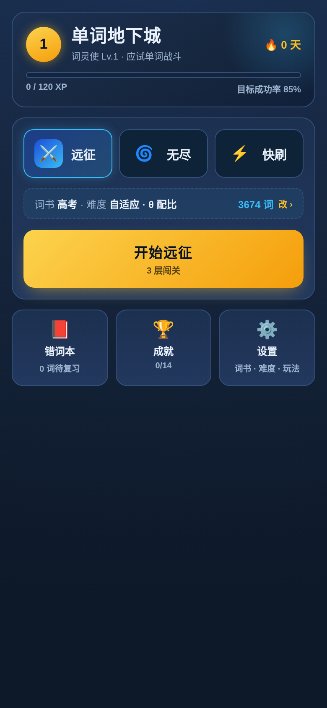
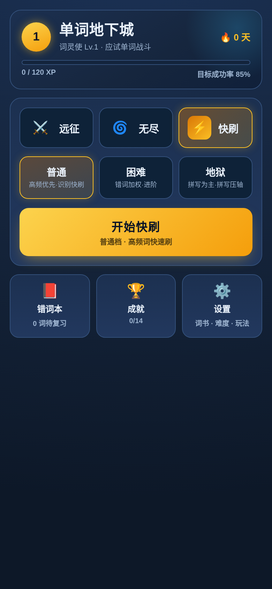
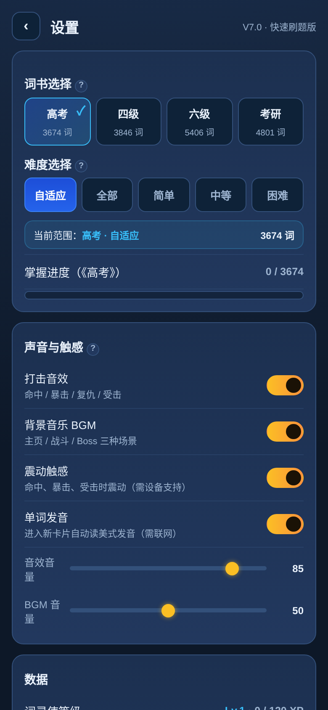
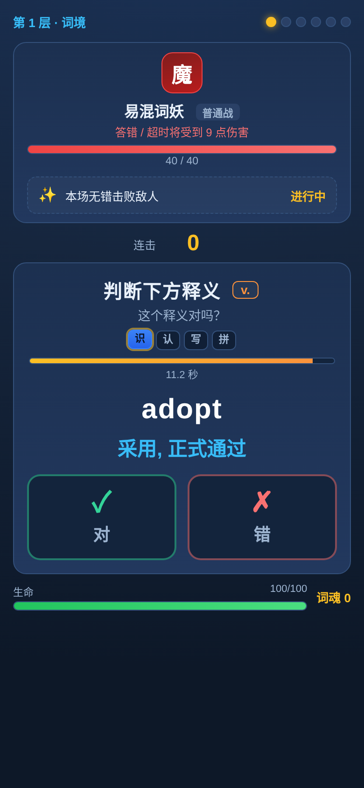
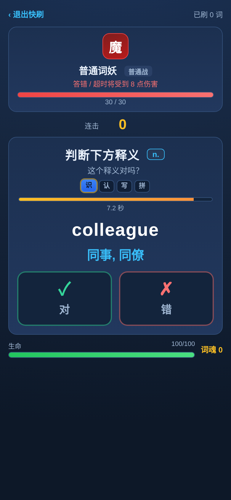
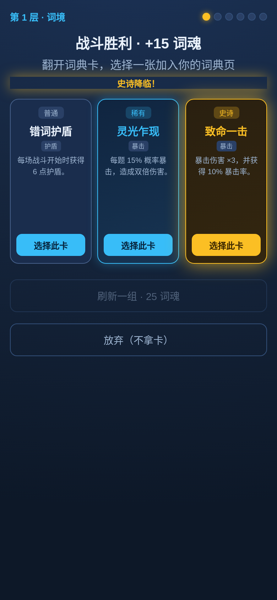
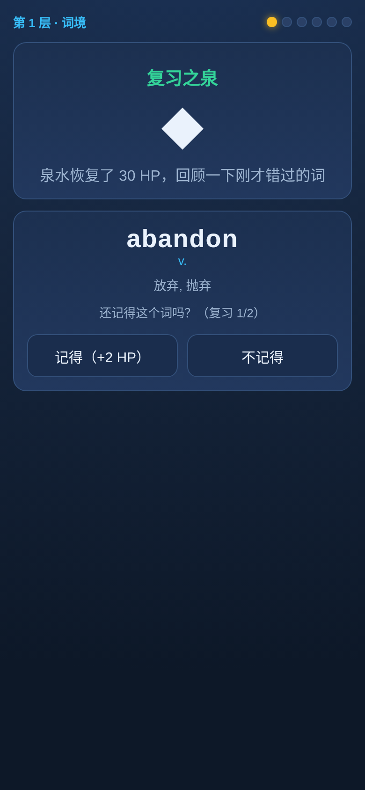
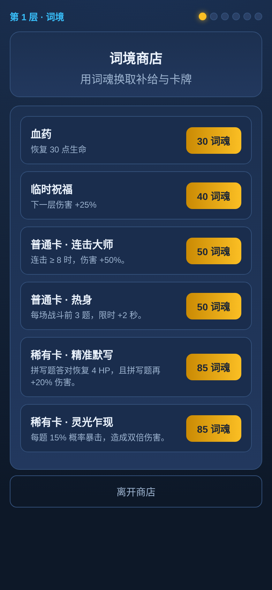
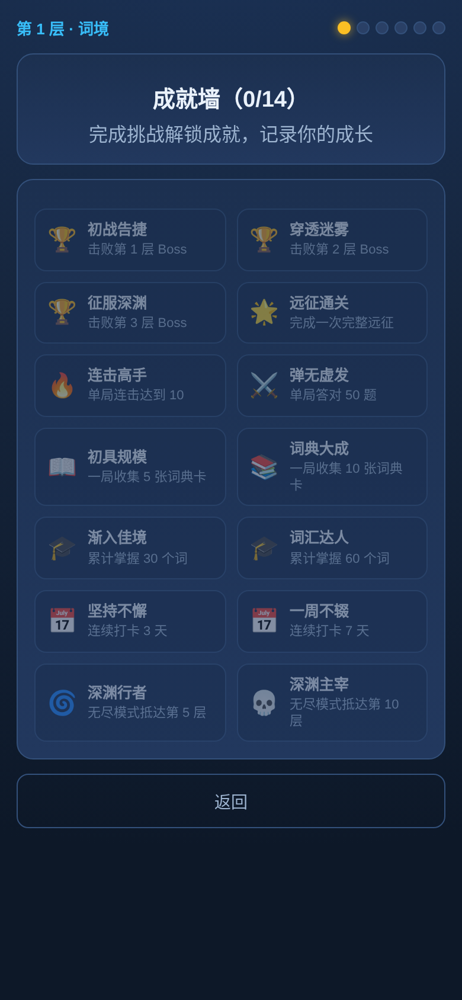
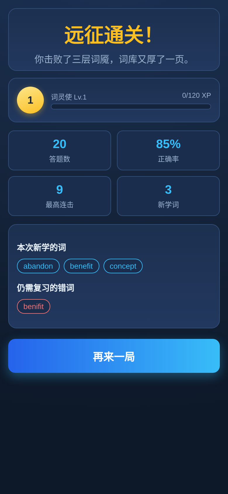

# split-frontend.md —— V7.0 前端 UI / 交互拆分交付物

> **供谁使用**：Agent2（前端迁移）。
> **当前代码位置提示**：`android/app/src/main/java/com/guzifeng/worddungeon/ui/`（MainActivity.java 路由 + Ui.java 样式工厂 + HomeView/SettingsView/BattleView/ResultView/WrongbookView/AchievementsView + AmbientBackground/RewardDrawView/HpBar）。
> **截图引用方式**：本文档与 `screenshots/` 目录同级，文中截图路径均为相对路径 `screenshots/xx.png`（11 张真机截图，viewport 390×844，来源：附录 C）。
> **内容来源**：逐条搬运自 `agent1-summary.md`，标注来源章节。数值/公式/存储键等后端内容见 `split-backend.md`。

---

## 1. 视觉基础

- **配色**：深蓝主题，`--bg0:#0d1828` 等 CSS 变量（`:root`，行 11-16）。（来源：§0 总览）
- **布局宽度**：`#app` 最大宽度 520px、手机视口全宽（行 24-26）。（来源：§0 总览）
- **无外部资源**：没有构建步骤、没有外部 JS 依赖、**没有外部音频文件**——音效/BGM 全部 Web Audio 实时合成。（来源：§0 总览；B5 声音/触感设置）

## 2. 词性 badge 视觉（来源：A1 词性处理）

- `posBadge(p)`（行 1406-1412）：把词性字段 `p` 按 `/` 切分，每个词性生成一个带色 badge。
- 配色映射 `POS_COLOR`（行 1405）：`n→cyan`、`v→orange`、`adj→green`、`adv→teal`、`prep→purple`、`conj/pron→mut`，未匹配一律 `--mut`。
- 展示位置：战斗题目标注词性（`qhead`，行 2970）、错词本列表（行 2874）、复习之泉（行 3071）。
- 释义文本：直接取词条 `m` 字段整串展示，不截断、不拆分（渲染侧责任）。（来源：A1 释义处理方式）

---

## 3. 功能清单（逐项 UI 实际行为）（来源：B5）

| 功能 | UI 实际行为 | 截图 |
|---|---|---|
| **主页** | 顶部横幅（等级徽章+标题+🔥连续打卡天数+XP 条）；中部发射卡（模式 tab + 开始按钮）；底部 dock 三入口（错词本/成就/设置）。`viewHome` 行 2513 |  |
| **三种模式** | 远征（3 层闯关）/ 无尽（无上限下潜）/ 快刷（高频词速刷）。tab 在主页切换（`homeMode`），选中态金色高亮。行 2563-2576 | `screenshots/01-home.png` |
| **快刷三档** | 主页选「快刷」后展开 普通/困难/地狱 三格按钮；文案分别为「高频优先·识别快刷 / 错词加权·进阶 / 拼写为主·拼写压轴」。行 2578-2585 |  |
| **词书选择** | 4 选 1：高考/四级/六级/考研，每格显示词数；切换即时过滤出题范围。`viewSettings` 行 2636-2642 |  |
| **难度选择** | 5 格：自适应/全部/简单/中等/困难；「自适应」按 θ 抽词，选具体档则锁定 tier。行 2644-2650 | `screenshots/02-settings.png` |
| **战斗** | 敌人卡（血条/受击演出）+ 连击 + 题目卡（题型/词性/阶梯/倒计时）+ 玩家 HUD（血/盾/词魂）。`viewBattle` 行 2918 | 、 |
| **抽卡（词典卡）** | 战斗胜利后翻 3 张 3D 卡（普通/稀有/史诗），可「刷新一组·25 词魂」或「放弃」；自动从低稀有到高稀有依次翻。`viewChoice` 行 2993 |  |
| **复习之泉** | 每层固定节点：先回 30 HP，再把本层错词（顽固>易错>生疏排序）做成「记得/不记得」复习，答对每词 +2 HP。`startSpring` 行 2430 |  |
| **词境商店** | 每层固定节点：血药 30 / 临时祝福 40（下一层伤害+25%）/ 普通卡 50 / 稀有卡 85 / 史诗卡 150，用「词魂」买。`startShop` 行 2467 |  |
| **错词本** | 独立视图：按错误次数分 顽固(≥3)/易错(=2)/生疏(=1) 三组列出，显示单词+词性+释义+错误次数+「在哪错过」标签；可「开始复习（顽固优先）」。`viewWrongBook` 行 2857 |  |
| **成就墙** | 14 个成就（清单数值见 split-backend.md），主页 dock 进入，未解锁半透明。`viewAchievements` 行 2747 |  |
| **每日目标** | 今日答对 40 题 / 新学 15 词 / 完成 1 次远征；主页与设置页显示进度。`C.daily` 行 896 | `screenshots/01-home.png`、`screenshots/02-settings.png` |
| **打卡 streak** | 完成一次远征才打卡（`markStreak`）；连续则 streak+1，断签重计；主页横幅显示「🔥 N 天」。行 1322-1335 | `screenshots/01-home.png` |
| **发音** | 战斗进入新单词卡自动读**美式发音**；走有道 `dict.youdao.com/dictvoice?audio=W&type=2` MP3；需联网，离线不发音不发请求。`WordSpeaker` 行 845-869 | —（注：与「零网络」总则的冲突见 acceptance-v1.md） |
| **声音/触感设置** | 音效/BGM/震动/发音 4 个开关 + 音效/BGM 两条音量滑条；全部 Web Audio 合成，无音频文件。`viewSettings` 行 2657-2685 | `screenshots/02-settings.png` |
| **数据清空** | 设置页底部「清空所有学习进度」（confirm 后 `Save.reset()`）。行 2743、3389 | — |

---

## 4. 页面设计与交互细节（来源：B6）

### 4.1 主页（`viewHome`）
- 布局：`home-banner`（等级圆徽 + 标题「单词地下城」+「词灵使 Lv.x · 应试单词战斗」+ 右上 🔥streak）→ 渐变 XP 条 → `launch-card`（3 模式 tab → 开始大按钮）→ `home-dock` 三宫格。
- 「开始」按钮为金色渐变（`.launch-btn`），下方小字显示模式描述。

### 4.2 设置页（`viewSettings`，单页聚合）
- 顶部 `subhead`：‹ 返回 + 标题「设置」+ 副标题「V7.0 · 快速刷题版」。
- 分组卡片：词书选择 / 难度选择 / 声音与触感 / 数据（等级/打卡/θ/今日目标/到期复习）/ 错词本入口 / 成就墙缩略 / 云端后端（可选）/ 怎么玩 / 关于。
- 每个分组标题旁有 ⓘ 角标（`.info-tip`），点击弹小窗 `#tipbox` 解释（`showTip` 行 3418）。

### 4.3 战斗页（`viewBattle`）—— 最复杂的视图
- 自上而下：顶栏（第 N 层词境 + 节点圆点进度）→ 心流/凝神横幅 → **敌人卡**（`.enemy`，脸 emoji「魔/精/魇」+ 名字 + 「答错/超时将受 X 点伤害」+ 红血条 + 本场微目标）→ **连击行**（金色大数字）→ **题目卡**（题面 + 词性 badge + 复仇徽章 + 题型阶梯 `识/认/写/拼` + 倒计时条 + 选项/拼写格）→ **玩家 HUD**（绿血条 + 盾 + 词魂）。
- **拼写输入抗卡顿实现**（`spellCells` 行 2886；`afterRender` 行 3249-3318）：隐藏 `<input>` + 一排字母格子；点格子/点提示自动聚焦；按键逐字母入格（`seq` 权威序列，抗输入法乱序/联想/纠错）；满格金色高亮，回车确认或等限时自动结算；答错先红抖展示错误拼写、0.6s 后换成正确答案变绿（`markOptions` 行 2077-2089）。
- **动效清单**：攻击斩击波 `.slash`、命中环 `.hitring`、粒子 `burst`、敌人受击 `enemyhit/enemycrit`、伤害飘字 `floatText`、屏幕红闪 `flashred`、低血量红 vignette（`.vignette.lowhp`）。

### 4.4 翻牌抽卡（`viewChoice`）
- 3 张 `.flip-card` 3D 翻转；自动按稀有度从低到高依次翻（`autoReveal` 行 3051），史诗压轴放金光粒子；底部「刷新一组 / 放弃」。

### 4.5 结算页（`viewResult`）
- 大标题（远征通关/失败/无尽抵达第 N 层）→ 等级卡（XP 条）→ 2×2 统计格（答题数/正确率/最高连击/新学词）→ 新学词 & 错词 chip 列表 → 再来一局按钮。

### 4.6 导航与返回
- 视图间切换靠 `data-act` 事件委托（`afterRender` 行 3349-3391）：`homeback` 回主页、`quickexit` 退快刷、`springdone/shopdone` 推进节点、`wrongback` 回主页。
- **Android 返回键**（`handleAndroidBack` 行 3432-3460；注册 `initAndroidBack` 行 3452-3460）：
  - 设置/错词本/成就/统计/怎么玩/结算 → 回主页；
  - 战斗 → 弹「放弃本层战斗？」确认框（`.backconfirm`，行 652-661）——二次确认防误触；
  - 抽卡/泉/商店 → 回战斗；
  - 主页 → `Capacitor.Plugins.App.exitApp()`。
  （来源：A5 Android 返回键；B6 导航与返回）

---

## 5. 题型交互规格（按钮文案 / 题面 / 控件 / 快捷键）（来源：A2 各题型规格表）

| 题型 | 题面（行 2965-2973） | 选项/控件 | 按钮文案 |
|---|---|---|---|
| `en2cn` | 显示英文单词 + 词性 badge，提示「选择正确的中文释义」 | 4 个释义按钮，带序号 1-4（行 2926-2927） | 直接显示释义文本 |
| `cn2en` | 显示中文释义 + 词性 badge，提示「选择正确的英文单词」 | 4 个英文按钮，带序号 1-4 | 直接显示单词文本 |
| `judge` | 「判断下方释义」+ 词性，下方显示一个释义，提示「这个释义对吗？」 | 2 个大按钮（行 2898-2901） | ✓「对」 / ✗「错」 |
| `spell` | 显示中文释义 + 词性，提示「根据释义默写英文单词」 | 隐藏 input + 字母格子（行 2886-2893） | 首字母提示 + 格子 |

- **键盘**：战斗中按数字 1–4 直接选前 4 个选项（行 3395-3403）；拼写题回车确认（行 3276-3279）。（注：Android 触屏机无硬键盘，该快捷键是否保留待 Agent2/Agent5 核对。）
- **倒计时交互**：拼写题填满则按当前内容判对/错，未填满按超时自动结算（`startTimer` 行 1882-1889）。

---

## 6. 成瘾性设计 · 交互侧演出（来源：B7）

### 6.1 连击与心流
- 答对 `combo++`，答错清零（有卡「势如破竹」则降半）；**连击行显示金色大数字**。
- **心流**：连击 ≥ `flow.threshold(5)` 进入（`G.flow=true`），全屏青色光晕 `flowglow` +「心 流」横幅。
- **凝神**：连续答错 `focus.wrongStreak(2)` 次 → 下一题限时 +2 秒，紫色「凝神」横幅。

### 6.2 暴击 / 复仇演出
- 暴击：橙色大字 + 斩击加重。
- **复仇徽章**：本局错过的词再次出现时，题目旁显示「⚔ 再战 · 伤害X%」金色脉冲徽章（行 2971）；答对触发「复仇 +N」红字 +「雪耻！」飘字（行 2186-2187）。

### 6.3 战斗微目标展示
- 每场战斗随机抽一个目标（连击达 4 / 答对 5 题 / 无错击败敌人），敌人卡下方实时显示进度（`BATTLE_GOALS` 行 1490-1494；奖励数值见 split-backend.md）。

### 6.4 成就 / 升级演出
- 解锁成就时顶部弹金色 toast「成就解锁」（`showAchToast` 行 1391）。
- 升级触发全屏金色放射演出「LEVEL UP · 词灵使 Lv.X」+ 粒子（`showLevelUp` 行 1354）。

---

## 7. 截图资产索引（来源：附录 C）

均存于本文档同级 `screenshots/` 目录（真机 Chromium 渲染，viewport 390×844）：

| 文件 | 视图 | 说明 |
|---|---|---|
| `screenshots/01-home.png` | 主页（远征默认） | 横幅/模式tab/开始/dock |
| `screenshots/02-settings.png` | 设置页 | 词书/难度/声音/数据/成就缩略 |
| `screenshots/03-wrongbook.png` | 错词本 | 分组列表 |
| `screenshots/04-achievements.png` | 成就墙 | 14 格 |
| `screenshots/05-home-quick.png` | 主页-快刷tab | 三档选择 |
| `screenshots/06-battle-quick.png` | 快刷战斗 | 退出口/已刷计数/judge题 |
| `screenshots/07-battle-campaign.png` | 远征战斗 | 敌人卡/微目标/阶梯/倒计时 |
| `screenshots/08-choice-flip.png` | 翻牌抽卡 | 三稀有度卡 |
| `screenshots/09-result.png` | 结算 | 统计格/词chip |
| `screenshots/10-spring.png` | 复习之泉 | 记得/不记得 |
| `screenshots/11-shop.png` | 词境商店 | 血药/祝福/卡牌 |

---

## 8. 与后端的边界说明

- 死代码/存疑清单（`C.question.pool`、`C.famIntervals`、`C.xp.master`、`cn2cn` 死分支等）见 `split-backend.md` 附录 B——前端**不要**按 `C.question.pool` 的权重做题型 UI 流程。
- 所有数值（三档参数、倍率、pity、奖励价格、成就条件、XP 公式）均在 `split-backend.md`，前端只负责演出与展示。
